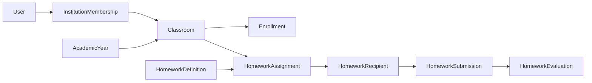

# Tam denetim

Okuma anı: 2026-11-06 12:41 +03. Kanonik kod: GitHub `main` `b09f51bbf9e75ae67e65d9632d1ac1e914d573c5`. Yerel layout worktree `fceeefd` bu SHA değildir. Mutasyon yok.

## 1. Kaynaklar ve tarih

| Kaynak | Ne zaman / hangi SHA | Bu rapordaki yeri |
|---|---|---|
| `AGENTS.md` | layout kopyası; aktif iş cümlesi X10 diyor | Güncel main `product-roadmap` X01 diyor. AGENTS satırı layout ağacında eski kalabilir. |
| `docs/product-roadmap.md` | main üzerinde X01 partial, X10 partial, M18 partial, #149 ayrı | Güncel ürün cümlesi |
| `features.json` / `baseline.json` | `git show b09f51b:…` | 73 feature, 72 baseline, active yalnız X01 |
| `architecture.md` | ci worktree (main+tanı commit’i dosyayı değiştirmedi) | Kuruluş + sonraki aşama notları karışık |
| `architecture-homework.md` | aynı | §0.1 uygulanan dilimler; §3 kısmen öneri başlığı |
| `docs/reports/testlig-*-2026-11-0*.md` | layout’ta staged, commit değil | 1–2 Kasım anlık görüntü. 5–6 Kasım merge’lerini içermez |
| Repo kök | `73c9c86` 2026-09-07 18:19 +03 “initialize Testlig platform foundation” | testlig-net başlangıcı |
| `testligtr-collab/web-projem` | API: var, default main, pushed_at 2026-09-07T12:19:02Z | İçerik okunmadı |

Eski raporlardaki “tamam” cümleleri bugünkü kabul değildir.

## 2. Durum sözlüğü (bu metinde kullanılan)

- **Present:** kayıt böyle diyor. Ürünün bittiği veya canlıda kabul edildiği anlamına gelmez.
- **Partial:** başarısız demek değildir. Kalan kapsam vardır.
- **CI yeşil:** o HEAD’deki workflow. Canlı kullanıcı değildir.
- **Deploy success:** o SHA’nın VDS’ye gittiği run. Pilot değildir.
- **HTTP 200:** sayfa cevap verdi. İşlev kabulü değildir.

## 3. Modüller M01–M31

Hepsi main `features.json` içinde en az bir feature ile var. Baseline 31 modül eksiksiz. Özet durum (ayrıntı CSV):

- Kayıt/giriş: M01 e-posta present, başvurular partial, deneme planned. M02 e-posta present; SMS partial; üye kodu, OAuth, misafir claim planned.
- Kullanıcı/kurum: M03 kullanıcı present, izinler partial, içe aktarma ve grup planned. M04 workspace present. M05 şube partial, banka verisi decision_needed. M06 sınıf ve yıl present, bağımsız sınıf decision_needed. M07 öğretmen alanı present, profil/editör partial.
- Öğrenme: M08 konu/test gezinme present, ilerleme planned. M09 veli bağ present, aktivite partial. M10 müfredat partial.
- Soru/test/sonuç: M11 present (AI import planned). M12 present (platform, kurum yazarlığı, sınıf teslimi, entitlement kaydı). M13 sonuç present, analitik ve manuel inceleme partial, export planned.
- Gelecek ürün: M14 canlı ders planned. M16 SMS sağlayıcı, M17 AI, M21 simülasyon, M22 oyun, M23 Q&A, M24 mesaj, M25 bildirim, M26 destek planned.
- Ticaret: M15 çekirdek present, checkout partial, kupon planned.
- Dosya: M18 bulut partial, yerel PDF present, kişisel dosya decision_needed. M19 doküman partial. M20 video partial.
- Site: M27 haber partial. M28 SEO partial. M29 CMS partial. M31 reklam decision_needed.
- Mobil: M30 API planned. X05 Flutter planned. X07 mobil kabul blocked.
- Çapraz: X01 ödev partial ve **tek active**. X02/X03 planned. X04 rehberlik decision_needed. X06 kalite partial. X08 sınıf pilotu blocked. X09 roadmap guard present (doğruluk garantisi değil). X10 admin kabuğu partial. X11 PHP envanter partial, baseline dışı.

Sessiz silinen baseline ID yok.

## 4. Mimari harita (main’de olan / olmayan)

Kimlik `User` + global `UserRole`. Kurum erişimi `Institution` + `InstitutionMembership`. Global öğretmen rolü tek başına kurum açmaz. Yıl/sınıf: `AcademicYear`, `Classroom`, `ClassroomTeacherAssignment`, `ClassroomStudentEnrollment` ve guard tabloları. Katalog ve içerik revision ayrı. Soru `Question` / revision. Test assessment revision, item, publication, attempt, answer. Entitlement erişim politikası test tesliminde. Ödev ayrı tablolar: definition, assignment, recipient, submission, evaluation, `current_evaluation_id`.

Kod karşılığı (main, isimler): `src/Entity/User.php`, `Institution.php`, `InstitutionMembership.php`, `AcademicYear.php`, `Classroom.php`, `HomeworkDefinition.php`, `HomeworkAssignment.php`, `HomeworkRecipient.php`, `HomeworkSubmission.php`, `HomeworkEvaluation.php`. Servisler `src/Service/Homework/`. Bu diyagram dosya teslimi, veli ve bildirimi içermez; onlar kodda yok.

`architecture.md` içindeki “sınıf UI yok” cümlesi kuruluş aşamasına aittir. Admin sınıf ekranları sonraki teslimlerle main’de (M06 present). İkisini aynı zaman diye okuma.

## 5. PR envanteri

`gh pr list --state all --limit 300`: 197 PR, numara 1–197. Tam tablo `02-pr-ci-deploy-kanitlari.csv`. Her PR gövdesindeki Roadmap-IDs satırı bu turda tek tek çekilmedi.

Açık (2026-11-06):

| PR | Dal | HEAD | Ne |
|---|---|---|---|
| 101 | docs/product-inventory-2026-10-06 | listede gövde okunmadı | Ekim envanter belgesi |
| 149 | feature/m18-clamav-app-connection-plan | b3c3bf87 | Soru görseli + ClamAV hazırlığı |
| 151 | feature/m27-news | — | Metin haber |
| 157 | feature/x11-lsphp83-security-apply | 793ec53 | lsphp83 güvenlik uygulama |
| 168 | feature/x06-ols-refresh | — | OLS worker refresh |
| 196 | chore/x01-195-merge-evidence | 54df678 | #195 merge/deploy kanıt metni. Yalnız docs |
| 197 | ci/browser-server-log-artifact | 041ca55 | Failure’da redakte PHP server log artifact |

#149, #157, #168 merge değil. Ürün X01 onları beklemeden #190–#195 ile main’e gitti. Bu, ops işinin bittiği anlamına gelmez.

## 6. Son 7 gün (2026-10-30 … 2026-11-06) main merge’leri

Yerel `git log b09f51b --since=2026-10-30` (113 commit satırı; aşağısı merge commit’ler):

| Zaman +03 | SHA | PR |
|---|---|---|
| 10-30 18:00 | 6f0d424 | #182 soru editör |
| 10-30 20:16 | 6e1a7b3 | #183 editör layout |
| 10-31 14:21 | 3397200 | #184 admin test listesi |
| 10-31 17:14 | add4a63 | #185 test editör |
| 11-01 12:58 | b78e8c4 | #186 test detay |
| 11-01 17:41 | 8afcf9a | #187 UTC/DST sabit anlar |
| 11-02 12:21 | ddea1f8 | #188 test önizleme |
| 11-02 19:23 | 13ae4b6 | #189 test sonuçları |
| 11-03 11:41 | 3c32350 | #190 ödev mimari belge |
| 11-03 15:06 | e72d150 | #191 öğretmen taslak |
| 11-03 19:38 | 512f262 | #192 atama + alıcı snapshot |
| 11-04 18:08 | 37a8544 | #193 öğrenci metin teslim |
| 11-04 21:01 | cc208c3 | #194 değerlendirme erişim kararı (docs) |
| 11-05 14:56 | b09f51b | #195 öğretmen değerlendirme |

Her ara commit’in CI’si bu tabloda yok. PR CI, `pull_request` için merge ref checkout eder (#196’da görüldü: `282b9a1`). Push main CI, merge SHA’yı çalıştırır.

Deploy (workflow Deploy VDS, son kayıtlar):

- `ddea1f8` #188 success 41423337468
- `13ae4b6` #189 success 41483975063
- `3c32350` #190 success 41608396730
- `e72d150` #191 success 41636752810
- `512f262` #192 success 41680875989
- `37a8544` #193 success 41860028646
- `cc208c3` #194 **failure** 41888866082
- `b09f51b` #195 **success** 42028237826

#186/#187 deploy satırı bu 8’lik listede yok; daha eski sayfa çekilmedi. Yokluk, yapılmadı kanıtı değildir.

## 7. X01 dilimleri (karıştırma)

| Dilim | PR | Main | Kod | Canlı uçtan uca |
|---|---|---|---|---|
| Mimari karar | #190 | evet | belge | gerekmez |
| Taslak metin | #191 | evet | definition draft | öğretmen kabulü yok |
| Atama snapshot | #192 | evet | assignment+recipient, tüm uygun öğrenciler | alıcı sayısı doğrulanmadı |
| Öğrenci teslim | #193 | evet | submission | boş liste görüldü; teslim yok |
| Erişim kararı | #194 | evet | belge | — |
| Değerlendirme | #195 | evet | evaluation + current pointer | öğretmen değerlendirmesi canlıda yok |
| Kanıt cümlesi | #196 | hayır | docs PR | — |
| 500 log tanı | #197 | hayır | workflow | exception yok |

#195 içindeki bilinen düzeltmeler (önceki inceleme, main’de): composite FK reddi, radio genişliği, etiket allowlist’i trim’siz, Symfony lock. Ayrı “yeni ürün” değildir.

## 8. #196 Browser ve #197

Başarısız: https://github.com/testligtr-collab/testlig-net/actions/runs/42029032547

- Checkout `282b9a13` merge ref, job head SHA alanı `54df678`.
- 4 passed sonra `admin-institutions` 1920 `GET /yonetim/kurumlar` → 500 “Bir sorun oluştu”.
- Screenshot/trace/error-context açıldı (önceki tur). Giriş formu yoktu.
- Aynı işte birkaç saniye önce 1440 isteği 200 ve `h1` Kurumlar idi.
- Sonraki testler `/giris` 500 ve `input[name=_csrf_token]` timeout. Bu CSRF tasarım hatası sayılmadı.
- PHP log artifact yoktu. Exception sınıfı bilinmiyor.
- #196 diff yalnız `docs/product-roadmap.md` ve `docs/roadmap/features.json`. Bu, 500’ün docs’tan geldiğini kanıtlamaz. Aynı uygulama ağacı #195 Browser’da 41 passed (run 42023013725, ~4.1 dk).

#197: https://github.com/testligtr-collab/testlig-net/pull/197 HEAD `041ca554cb11d4de219944e9464d72539c5d2dba`.

- Tek `pull_request` CI: run 42052914409. Quality SUCCESS, Browser SUCCESS, coverage SUCCESS.
- Browser süresi yaklaşık 5 dk. 1.4 saatlik timeout kaskadı yok.
- Artifact: `browser-screenshots` var. `browser-server-log` yok. Failure-only adım çalışmış sayılmaz; job fail olmadığı için adım atlanır. Bu dürüst sonuçtur.
- Uygulama, login helper, CSRF, worker, timeout, retry değişmedi. `APP_DEBUG=0` duruyor.
- “Tekrar üretilemedi.” Kök neden bulunmadı ve çözülmedi.

## 9. Güvenlik envanteri (kod/test adı; bu turda test koşulmadı)

Main’de bulunan ve test dosyası olan başlıklar (varlık, o HEAD’de yeşil koşu değildir):

- Aktif doğrulanmış aktör: `PrivilegedUserActorGuard`, `ActiveVerifiedUserPolicy`, `FreshUserLoader`.
- Rol ve üyelik ayrımı: `InstitutionVoter`, membership role enum. Global rol kurum açmaz.
- Ödev nesnesi: `HomeworkDefinitionVoter`, `HomeworkEvaluationVoter`.
- CSRF: teacher/student form token’ları; Browser `support.ts` `login()` token bekler. Kaldırılmadı.
- Çakışma: evaluation `expected_current_evaluation_id`.
- Kilit sırası: homework manager testleri ve `HomeworkAssignmentConcurrencyTest`, `HomeworkSubmissionConcurrencyTest`, `HomeworkEvaluationConcurrencyTest`.
- Unique: assignment definition, recipient kimliği (migration yorumları evidence’de).
- Append-only evaluation: `HomeworkEvaluationManager`.
- GET yazmaz: controller testleri `TeacherHomeworkHttpTest`, `StudentHomeworkHttpTest`.
- Unicode: `HomeworkText` mb_strlen sınırları.
- UTC: #187 `M13-results` evidence sabit an offset’i. Tarihe bağlı DST varsayımı bırakıldı.
- Cevap anahtarı: test önizleme/sonuç testleri anahtarı öğrenciye açmama iddiasını taşır. Bu denetim production’da doğrulamadı.
- Private dosya/ClamAV: M18 partial, #149 açık. Ödev dosyası yok.

Gözlenen ve bu turda kanıtlanan yeni production açığı yok. Bilinmeyen 500 CI içindedir, production isteği değildir.

## 10. Bağımlılık ve operasyon

`composer.json` @ `b09f51b`: PHP `>=8.2`. Symfony bileşenleri `7.4.*`. Doctrine ORM `^3.6`. MariaDB hedefi mimaride 10.11. CI PHP 8.3. Sunucu lsphp işi #157 açık; Composer sürümü ile sunucu paketi aynı iş değildir.

Composer audit’in “temiz” olduğu SHA #195 kalite job’udur. Sonraki advisory’yi kapsamaz.

SSH/pause: safety skill `VDS_SSH_PAUSED` iken deploy yok der. Bu denetim değişkeni okumadı. Doğrulanamadı. SSH açılmadı.

## 11. Canlı kabul (yeniden test yok)

Önceki salt okunur bakış, bu raporda yenilenmedi:

- Öğrenci ödev listesi boş görüldü. Zincir kabulü değil.
- Öğretmen `/calisma-alani` o oturumda kapalıydı. “Öğretmen hesabı yok” demek değildir.
- Admin test ekranları CI screenshot ve main kodudur. Bu turda canlı tıklama yok.
- Deploy health, pilot değildir.

## 12. Ne bu raporda yapılmadı

Kod, workflow, roadmap dosyası, branch, commit, push, PR yorumu, rerun, dispatch, Docker, XAMPP, SSH, production yazımı yok. Yeni feature ID yok.
